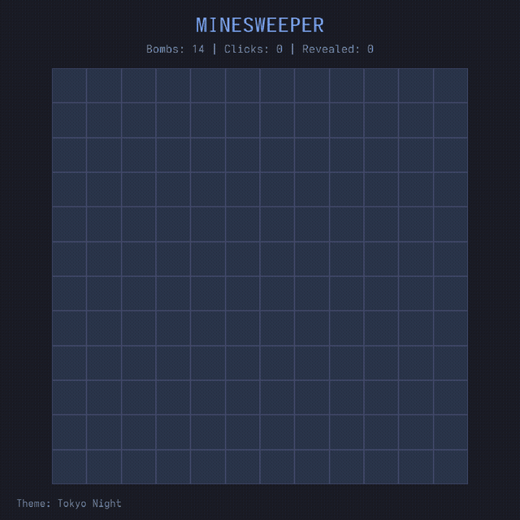
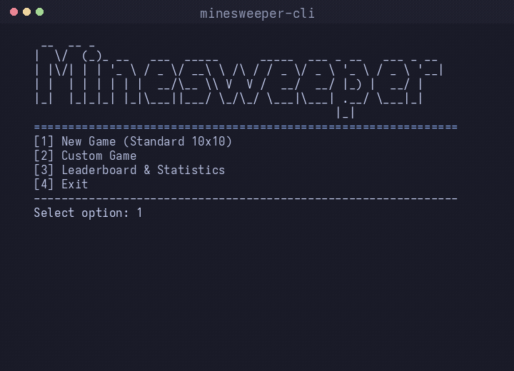

# Minesweeper

A C++ implementation of the Minesweeper game with both CLI and GUI interfaces.

<p align="center">
  
  
</p>

## Features

- classic minesweeper gameplay with reveal, flag, chord and double-click chord
- CLI menu and GUI menu with the same game state
- leaderboard with CRUD, sorting and filtering
- recent match history
- multiple GUI themes: `Tokyo Night`, `OLED Black`, `Adwaita`, `Monokai`
- custom exception hierarchy and try/catch based error handling
- template utilities used in real gameplay logic
- STL containers and algorithms
- `std::string` everywhere instead of manual C strings
- `IObject` interface with unique ids and polymorphic `toString()`
- singleton `ThemeManager` implemented as a Meyers singleton
- singleton `Logger` with journal persistence and menu access
- abstract factory for runtime theme selection
- builder for game setup creation

## Build

Linux / macOS:
```bash
./build.sh
```

Windows:
```batch
build.bat
```

The scripts above build the project in CMake's `Debug` configuration by default,
which also enables the project's `DEBUG` macro inside the codebase.

To force a release build locally, pass the build type explicitly:
```bash
BUILD_TYPE=Release ./build.sh
```

```batch
build.bat Release
```

The GitHub Actions workflow only builds `Release` binaries.

Build outputs:
- `build/minesweeper` - CLI version
- `build/minesweeper-gui` - GUI version
- `build/minesweeper-benchmark` - benchmark utility
- `build/minesweeper-animation-demo` - map generation animation demo

## Dependencies

- `raylib` - GUI rendering
- `PCG` - random number generation with AVX2 SIMD acceleration
- `CMake` - build system
- `C++23` - language standard

### Installing dependencies on Windows

To set up the environment on a clean Windows installation, run the following commands in **PowerShell**:

```powershell
# 1. Install Scoop (Package Manager)
Set-ExecutionPolicy -ExecutionPolicy RemoteSigned -Scope CurrentUser
Invoke-RestMethod -Uri https://get.scoop.sh | Invoke-Expression

# 2. Install Build Tools
scoop install gcc make cmake

# 3. Install Raylib (MinGW version)
scoop bucket add extras
scoop install raylib-mingw
```

## Build Optimizations

Builds are produced with aggressive optimization flags for maximum performance:

- `-O3` - Aggressive optimization level
- `-march=native` - CPU-specific instructions (AVX2, SSE4, etc.)
- `-flto` - Link-Time Optimization for whole-program optimization
- `PCG with AVX2` - SIMD-accelerated random number generation

## License

This project is licensed under the [GNU General Public License v3.0](LICENSE).
